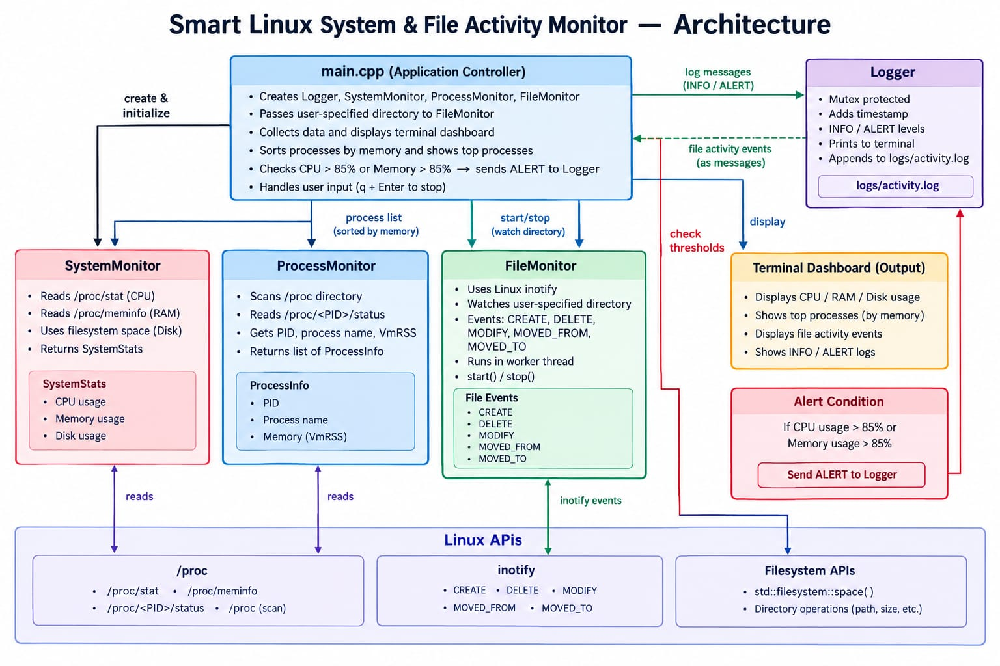

# Smart Linux System & File Activity Monitor

A C++ based Linux application that monitors system resources, running processes, and file system activities in real time.

## Project Overview

Smart Monitor is a lightweight terminal-based monitoring application developed using C++ and Linux system interfaces.

It monitors CPU, RAM, disk usage, running processes, and file activities. It also provides alerts for high resource usage and records important activities in a log file.

## Key Features

- CPU usage monitoring
- RAM usage monitoring
- Disk usage monitoring
- Running process monitoring
- Process memory usage monitoring
- File creation, deletion and modification detection
- File movement detection
- CPU and RAM usage alerts
- Timestamped activity logging
- Terminal-based monitoring dashboard
- Multithreading for file monitoring

## System Architecture

The project is divided into four main components:

- **SystemMonitor** – Monitors CPU, RAM and disk usage.
- **ProcessMonitor** – Detects running processes and their memory usage.
- **FileMonitor** – Monitors file system activities using Linux `inotify`.
- **Logger** – Records INFO and ALERT messages with timestamps.

The application uses Linux `/proc`, `inotify`, and filesystem APIs to collect monitoring information.

## Technologies Used

- C++
- Linux
- CMake
- Linux `/proc`
- Linux `inotify`
- C++ STL
- Multithreading
- Mutex and synchronization
- Git and GitHub

## Requirements

- Ubuntu/Linux
- C++ compatible compiler
- g++
- CMake 3.10 or newer
- POSIX Threads
